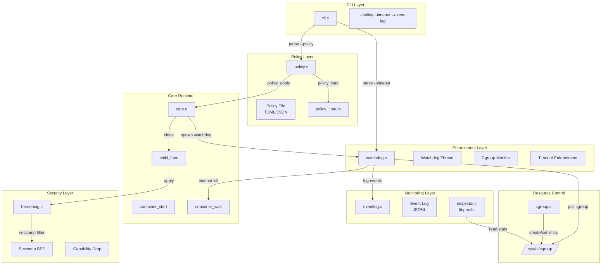
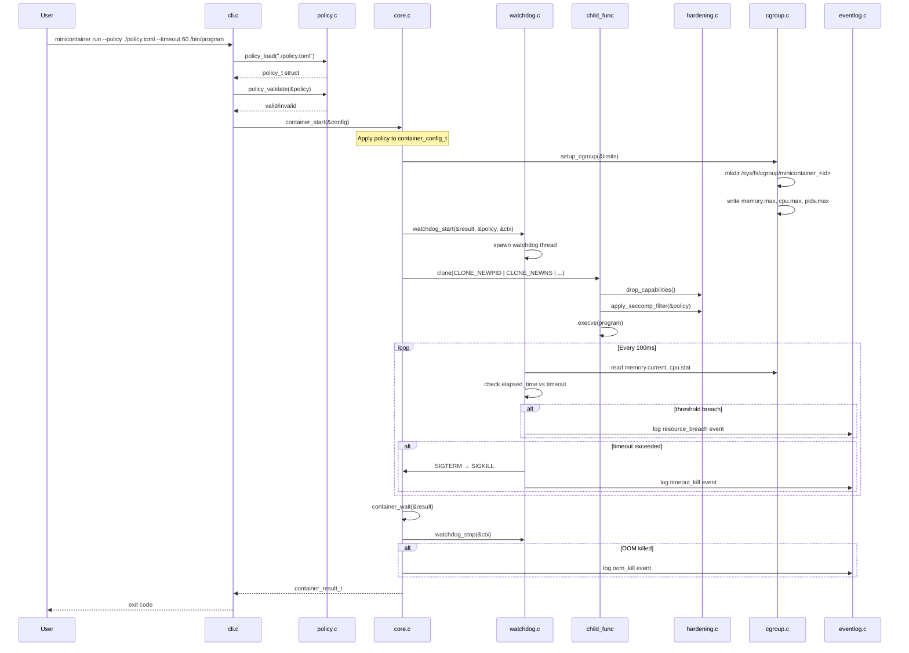
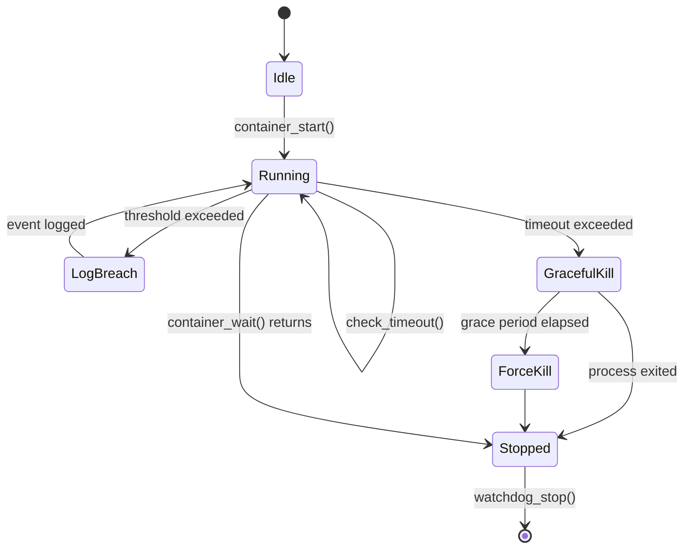
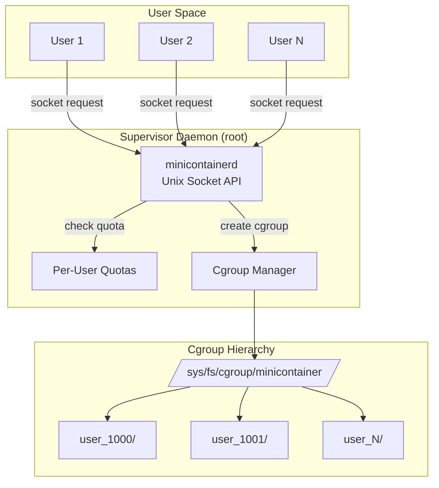

# Design Document: Secure Workload Execution

## Overview

This design extends minicontainer (a minimal container runtime in C) with policy, monitoring, and enforcement layers for multi-user shared computing infrastructure. The goal is to enable educational institutions and shared computing facilities to safely execute untrusted programs while maintaining resource efficiency and operational visibility.

The design introduces three new modules (`policy.c`, `watchdog.c`, `eventlog.c`) that integrate with existing Phase 8c capabilities (namespaces, cgroups, seccomp hardening, introspection) to create a comprehensive secure execution environment.

---

## Architecture

### High-Level Component Diagram



### Data Flow Diagram



---

## Components

### 1. Policy Module (`policy.c` / `policy.h`)

**Purpose**: Load, validate, and apply policy files that specify resource limits, syscall restrictions, and behavioral constraints.

**Responsibilities**:
- Parse policy files (TOML or JSON format)
- Validate policy values (no negative limits, known syscalls, valid paths)
- Map policy fields to `container_config_t` and seccomp configuration
- Provide sensible defaults when policy file is absent
- Support per-user policy overrides via directory structure

**Integration Points**:
- Called from `cli.c` during flag parsing
- Outputs to `container_config_t` fields
- Outputs to seccomp filter generation in `hardening.c`
- Outputs to watchdog timeout configuration

### 2. Watchdog Module (`watchdog.c` / `watchdog.h`)

**Purpose**: Monitor container execution in real-time, enforce wall-clock timeouts, and detect resource threshold breaches.

**Responsibilities**:
- Run in a separate thread during container execution
- Poll cgroup stats at configurable intervals (default: 100ms)
- Track elapsed wall-clock time vs timeout limit
- Log resource threshold breaches (memory > 90%, CPU sustained > 80%)
- Kill container on timeout (SIGTERM → grace period → SIGKILL)
- Coordinate with `container_wait()` for clean shutdown

**Integration Points**:
- Started by `core.c::container_start()` after clone
- Reads cgroup stats via `libprocfs` or direct file reads
- Logs events via `eventlog.c`
- Sends signals to child process on timeout

### 3. Event Logging Module (`eventlog.c` / `eventlog.h`)

**Purpose**: Persist execution events to append-only JSONL files for auditing, debugging, and resource accounting.

**Responsibilities**:
- Write events in JSON Lines format (one JSON object per line)
- Support multiple event types: resource_breach, syscall_denied, timeout_kill, oom_kill
- Ensure atomic writes (line buffering, flush on each event)
- Rotate logs by container ID
- Provide query interface for `logs` subcommand

**Integration Points**:
- Called from `watchdog.c` for resource/timeout events
- Called from `core.c` for OOM kill detection
- Called from child-side for seccomp denial logging (limited)
- Queried by new `logs` subcommand in `cli.c`

---

## Policy File Format

### Format Choice: TOML

**Rationale**:
- Human-readable and easy to edit by system administrators
- Clear section structure maps well to policy domains
- More readable than JSON for nested configurations
- Can use existing TOML parser (tomlc99 or similar, ~500 lines)
- Alternative: Reuse Phase 8c JSON parser for consistency

### Example Policy File

```toml
# /etc/minicontainer/policies/default.toml
# Default policy for untrusted student workloads

[policy]
name = "default"
version = "1.0"
description = "Standard student workload policy"

[resources]
# Memory limit: 512 MB
memory = "512M"

# CPU limit: 50% of one core
cpu = 0.5

# Maximum processes: 50 (fork bomb defense)
pids = 50

# Wall-clock timeout: 5 minutes
timeout = 300

# Grace period before SIGKILL after SIGTERM
grace_period = 10

[resources.thresholds]
# Log warning when memory usage exceeds 90%
memory_warning = 0.9

# Log warning when CPU sustained > 80% for 5+ seconds
cpu_warning = 0.8
cpu_warning_duration = 5

[security]
# Enable hardening (equivalent to --secure)
enable_hardening = true

# Use default seccomp profile (extend from Phase 8b base)
seccomp_profile = "default"

# Block specific syscalls in addition to base profile
blocked_syscalls = [
    "reboot",
    "kexec_load",
    "kexec_file_load",
    "init_module",
    "finit_module",
    "delete_module",
    "acct",
    "swapon",
    "swapoff"
]

# Filesystem access rules
[security.filesystem]
# Read-only paths (remounted MS_RDONLY)
readonly_paths = [
    "/etc/passwd",
    "/etc/shadow",
    "/etc/sudoers"
]

# Masked paths (bind to /dev/null)
masked_paths = [
    "/proc/kcore",
    "/proc/latency_stats",
    "/proc/timer_list",
    "/proc/timer_stats"
]

# Denied paths (return EACCES on open - requires path-based checks)
# Note: This is complex to implement; consider future work
denied_paths = []

# Network restrictions
[security.network]
# Allow outbound network access (if --net is used)
allow_outbound = true

# Allowed outbound ports (empty = all)
allowed_ports = [80, 443, 22]

# Deny specific hosts (not implemented in Phase 1)
denied_hosts = []

[logging]
# Enable event logging
enabled = true

# Log directory
log_dir = "/var/log/minicontainer/events"

# Log resource breaches
log_resource_breaches = true

# Log seccomp denials (requires kernel support)
log_seccomp_denials = true

# Log level: debug, info, warn, error
level = "info"
```

### Policy to `container_config_t` Mapping

```c
// policy.h
typedef struct {
    // Metadata
    char name[64];
    char version[16];
    char description[256];
    
    // Resources
    uint64_t memory_limit;      // bytes
    double cpu_limit;           // fraction of one core
    uint32_t pids_limit;        // max processes
    uint32_t timeout;           // seconds, 0 = no timeout
    uint32_t grace_period;      // seconds before SIGKILL
    
    // Thresholds
    double memory_warning_threshold;  // 0.0-1.0
    double cpu_warning_threshold;     // 0.0-1.0
    uint32_t cpu_warning_duration;    // seconds
    
    // Security
    bool enable_hardening;
    char seccomp_profile[64];
    char **blocked_syscalls;    // NULL-terminated array
    size_t blocked_syscall_count;
    
    // Filesystem
    char **readonly_paths;
    size_t readonly_path_count;
    char **masked_paths;
    size_t masked_path_count;
    
    // Network
    bool allow_outbound;
    uint16_t *allowed_ports;
    size_t allowed_port_count;
    
    // Logging
    bool log_enabled;
    char log_dir[PATH_MAX];
    bool log_resource_breaches;
    bool log_seccomp_denials;
} policy_t;

// Apply policy to container_config_t
void policy_apply(const policy_t *policy, container_config_t *cfg);
```

---

## Event Schema

### JSONL Event Format

Events are written as single-line JSON objects to `/var/log/minicontainer/events/<container_id>.jsonl`.

```json
{
  "timestamp": "2026-10-12T14:32:05.123Z",
  "container_id": "a1b2c3d4e5f6",
  "event_type": "resource_breach",
  "details": {
    "resource": "memory",
    "current_bytes": 471859200,
    "limit_bytes": 536870912,
    "threshold": 0.9,
    "percentage": 0.88
  }
}
```

### Event Types

#### 1. `resource_breach`
Logged when a resource threshold is exceeded (warning, not kill).

```json
{
  "event_type": "resource_breach",
  "details": {
    "resource": "memory|cpu|pids",
    "current_value": <number>,
    "limit_value": <number>,
    "threshold": <number>,
    "percentage": <number>
  }
}
```

#### 2. `timeout_kill`
Logged when container is killed due to wall-clock timeout.

```json
{
  "event_type": "timeout_kill",
  "details": {
    "timeout_seconds": 300,
    "elapsed_seconds": 300.05,
    "signal": "SIGTERM|SIGKILL",
    "grace_period_used": true
  }
}
```

#### 3. `oom_kill`
Logged when container is OOM-killed by kernel.

```json
{
  "event_type": "oom_kill",
  "details": {
    "memory_limit_bytes": 536870912,
    "memory_peak_bytes": 550000000,
    "exit_code": 137
  }
}
```

#### 4. `syscall_denied`
Logged when seccomp denies a syscall (requires SECCOMP_RET_LOG or ptrace).

```json
{
  "event_type": "syscall_denied",
  "details": {
    "syscall": "mount",
    "syscall_number": 165,
    "error": "EPERM",
    "args": [<optional, may be truncated>]
  }
}
```

#### 5. `container_start`
Logged when container starts (for audit trail).

```json
{
  "event_type": "container_start",
  "details": {
    "program": "/bin/python3",
    "argv": ["python3", "script.py"],
    "policy": "default",
    "user_id": 1000,
    "resource_limits": {
      "memory": "512M",
      "cpu": 0.5,
      "pids": 50,
      "timeout": 300
    }
  }
}
```

#### 6. `container_exit`
Logged when container exits (for audit trail).

```json
{
  "event_type": "container_exit",
  "details": {
    "exit_code": 0,
    "exit_reason": "normal|signal|oom|timeout",
    "wall_clock_seconds": 45.2,
    "cpu_time_seconds": 12.5,
    "memory_peak_bytes": 134217728
  }
}
```

---

## Watchdog Thread Design

### Architecture



### Watchdog Context Structure

```c
// watchdog.h
typedef struct {
    // Input parameters
    pid_t child_pid;
    uint32_t timeout_seconds;
    uint32_t grace_period_seconds;
    double memory_warning_threshold;
    double cpu_warning_threshold;
    uint32_t cpu_warning_duration;
    bool log_breaches;
    
    // Internal state
    pthread_t thread;
    volatile bool running;
    pthread_mutex_t lock;
    pthread_cond_t stop_cond;
    
    // Cgroup path for stat reads
    char cgroup_path[PATH_MAX];
    
    // Timing
    struct timespec start_time;
    struct timespec last_cpu_check;
    double last_cpu_usage;
    uint32_t cpu_high_duration;  // seconds above threshold
    
    // Event log
    char event_log_path[PATH_MAX];
    
    // Result (set on stop)
    bool timeout_killed;
    bool grace_period_used;
} watchdog_context_t;
```

### Watchdog Thread Pseudocode

```pascal
PROCEDURE watchdog_thread(arg)
  INPUT: arg (watchdog_context_t*)
  OUTPUT: NULL (result stored in context)
  
  LOCALS:
    ctx: watchdog_context_t*
    now, elapsed: struct timespec
    memory_current, memory_limit: uint64_t
    cpu_usage: double
    memory_pct, cpu_pct: double
    
  BEGIN
    ctx ← arg
    
    WHILE ctx->running DO
      // Sleep for poll interval (100ms)
      nanosleep(100ms)
      
      // Check timeout
      clock_gettime(CLOCK_MONOTONIC, now)
      elapsed ← now - ctx->start_time
      IF elapsed >= ctx->timeout_seconds THEN
        // Timeout exceeded - initiate kill
        ctx->timeout_killed ← true
        kill(ctx->child_pid, SIGTERM)
        eventlog_append(ctx->event_log_path, TIMEOUT_KILL, ...)
        
        // Wait grace period
        sleep(ctx->grace_period_seconds)
        
        // Check if still alive
        IF kill(ctx->child_pid, 0) = 0 THEN
          // Process still running - force kill
          kill(ctx->child_pid, SIGKILL)
          ctx->grace_period_used ← true
        END IF
        
        ctx->running ← false
        RETURN NULL
      END IF
      
      // Poll cgroup stats
      IF ctx->log_breaches THEN
        memory_current ← read_cgroup_stat(ctx->cgroup_path, "memory.current")
        memory_limit ← read_cgroup_stat(ctx->cgroup_path, "memory.max")
        
        IF memory_limit > 0 THEN
          memory_pct ← memory_current / memory_limit
          IF memory_pct >= ctx->memory_warning_threshold THEN
            eventlog_append(ctx->event_log_path, RESOURCE_BREACH, 
                           "memory", memory_current, memory_limit, memory_pct)
          END IF
        END IF
        
        // CPU check (requires tracking delta)
        cpu_usage ← compute_cpu_usage(ctx)
        IF cpu_usage >= ctx->cpu_warning_threshold THEN
          ctx->cpu_high_duration ← ctx->cpu_high_duration + 0.1
          IF ctx->cpu_high_duration >= ctx->cpu_warning_duration THEN
            eventlog_append(ctx->event_log_path, RESOURCE_BREACH,
                           "cpu", cpu_usage, 1.0, cpu_usage)
          END IF
        ELSE
          ctx->cpu_high_duration ← 0
        END IF
      END IF
    END WHILE
    
    RETURN NULL
  END
END PROCEDURE
```

### Integration with container_start/container_wait

```c
// In core.c

container_result_t container_start(const container_config_t *config) {
    // ... existing setup (cgroup, clone, etc.) ...
    
    // Start watchdog if timeout or monitoring is configured
    watchdog_context_t watchdog_ctx = {0};
    if (config->timeout > 0 || config->enable_monitoring) {
        watchdog_ctx.child_pid = pid;
        watchdog_ctx.timeout_seconds = config->timeout;
        watchdog_ctx.grace_period_seconds = config->grace_period;
        // ... copy other config fields ...
        
        if (watchdog_start(&result, config, &watchdog_ctx) < 0) {
            fprintf(stderr, "[parent] Failed to start watchdog\n");
            // Continue without watchdog - container still runs
        }
    }
    
    // Store watchdog context in result for container_wait
    result.watchdog_ctx = watchdog_ctx;
    
    return result;
}

void container_wait(container_result_t *result, bool enable_debug) {
    // ... existing waitpid logic ...
    
    // Stop watchdog
    if (result->watchdog_ctx.running) {
        watchdog_stop(&result->watchdog_ctx);
    }
    
    // Log container exit event
    if (result->ctx.event_log_enabled) {
        event_t exit_event = {
            .type = EVENT_CONTAINER_EXIT,
            .timestamp = time(NULL),
            .container_id = result->container_id,
            .details = {
                .exit_code = result->exit_status,
                .exit_reason = result->exited_normally ? "normal" : 
                               (result->signal == 9 ? "oom" : "signal"),
                // ... other fields ...
            }
        };
        eventlog_append(result->ctx.event_log_path, &exit_event);
    }
    
    // ... existing cleanup ...
}
```

---

## Seccomp Extension from Policy

### Current Implementation (Phase 8b)

The existing `hardening.c` uses a hand-rolled BPF program with a fixed allow-list of 210 syscalls. The program is assembled directly as `struct sock_filter` instructions.

### Extension Approach

**Option A: Extend the fixed allow-list at runtime**

```c
// hardening.h
typedef struct {
    const char **additional_blocked;  // syscalls to block beyond base
    size_t additional_blocked_count;
    const char **additional_allowed;  // syscalls to allow beyond base
    size_t additional_allowed_count;
} seccomp_policy_t;

int apply_seccomp_filter_with_policy(const seccomp_policy_t *policy);
```

**Implementation**:
1. At filter generation time, iterate the syscall table
2. For each syscall in `additional_blocked`, emit a BPF rule returning `SECCOMP_RET_ERRNO | EPERM`
3. For each syscall in `additional_allowed`, skip the block rule (allow it through)
4. This requires knowing syscall numbers, which are architecture-dependent

**Challenge**: The BPF program is generated at compile time for the base profile. Extending it at runtime requires either:
- Pre-generating multiple profiles and selecting one
- Generating BPF at runtime (complex)
- Using a two-pass approach: first pass allows base, second pass blocks additional

**Option B: Two-layer approach (recommended for Phase 4)**

```c
// Child applies base seccomp filter
apply_seccomp_filter_base();  // Phase 8b hardcoded

// If policy specifies blocked syscalls, apply additional filter
if (policy->blocked_syscall_count > 0) {
    apply_seccomp_filter_blocked(policy->blocked_syscalls);
}
```

The second filter checks only the blocked syscalls and returns `EPERM`. This is simpler but adds BPF overhead.

**Option C: Use SECCOMP_RET_LOG for denied syscalls (kernel 4.14+)**

```c
// In BPF program
BPF_JUMP(BPF_JMP+BPF_JEQ+BPF_K, SYS_number, 0, 1),
BPF_STMT(BPF_RET+BPF_K, SECCOMP_RET_LOG),  // Log and allow
```

This logs denied syscalls to the kernel audit log, which can be read via `ausearch` or `journalctl`. Not as integrated as our own JSONL, but avoids ptrace complexity.

### Recommended Approach for Phase 1-3

Use the existing Phase 8b hardcoded allow-list without extension. Policy can only enable/disable hardening entirely. Syscall extension is deferred to Phase 4 (if time permits).

---

## Multi-User Architecture

### Problem Analysis

The README states: "Cgroup operations always require root — /sys/fs/cgroup/ is root-owned. `--user` (rootless) cannot write cgroup files."

This is a fundamental constraint: unprivileged users cannot create cgroups or write resource limits.

### Option A: Supervisor Daemon (Recommended)

**Architecture**:



**Protocol**:

```c
// Unix socket protocol
struct daemon_request {
    uint32_t version;
    uint32_t action;         // RUN, STOP, LIST, INSPECT
    uid_t    requesting_uid;
    gid_t    requesting_gid;
    
    // For RUN action
    container_config_t config;
    char     policy_path[PATH_MAX];
};

struct daemon_response {
    uint32_t status;         // OK, ERROR, QUOTA_EXCEEDED
    char     container_id[13];
    pid_t    child_pid;
    char     error_message[256];
};
```

**Per-User Quotas**:

```toml
# /etc/minicontainer/daemon.conf
[daemon]
socket_path = "/run/minicontainerd.sock"
max_containers = 100

[quota.default]
max_containers_per_user = 5
total_memory_per_user = "2G"
total_cpu_per_user = 2.0

[quota.1000]  # Override for UID 1000
max_containers_per_user = 10
total_memory_per_user = "4G"
```

**Pros**:
- Works for all users without sudo
- Centralized quota enforcement
- Audit trail of all requests
- Can implement priority scheduling

**Cons**:
- Significant development effort
- Requires socket protocol design
- Single point of failure
- Security: socket must verify peer credentials

### Option B: Delegated Cgroups (Alternative)

**Setup** (requires admin action):

```bash
# Admin creates per-user cgroup subtrees
for uid in $(seq 1000 1010); do
    mkdir -p /sys/fs/cgroup/minicontainer/user_$uid
    chown -R $uid:$uid /sys/fs/cgroup/minicontainer/user_$uid
    echo "+memory +cpu +pids" > /sys/fs/cgroup/minicontainer/cgroup.subtree_control
done
```

**Usage**:

```c
// User can now create children under their subtree
// minicontainer creates /sys/fs/cgroup/minicontainer/user_1000/container_<id>/
```

**Pros**:
- No daemon required
- Simpler implementation
- Works with existing CLI

**Cons**:
- Requires admin setup for each user
- No dynamic quota enforcement
- Users can exceed intended limits if subtree isn't constrained

### Option C: Root Required for Resource Limits

**Approach**: Document that resource limits require sudo, but isolation (`--user`) works without it.

**Implementation**: No code changes. Update README and error messages.

```bash
# Works without sudo (isolation only)
./minicontainer --user --pid --rootfs ./rootfs /bin/sh

# Requires sudo for resource limits
sudo ./minicontainer --user --pid --rootfs ./rootfs --memory 100M /bin/sh
```

**Pros**:
- Zero development effort
- Works today
- Clear security model

**Cons**:
- Users cannot self-service
- Requires shared sudo access or wrapper scripts

### Recommendation for Semester Project

**Phase 1-4**: Option C (document root requirement)
**Phase 5 (if time permits)**: Option B (delegated cgroups with setup script)

The supervisor daemon (Option A) is valuable but outside the 6-10 week scope.

---

## Data Structures

### policy_t

```c
// policy.h
#ifndef POLICY_H
#define POLICY_H

#include <stdint.h>
#include <stddef.h>
#include <stdbool.h>
#include "core.h"

#define POLICY_NAME_MAX 64
#define POLICY_VERSION_MAX 16
#define POLICY_DESCRIPTION_MAX 256
#define MAX_BLOCKED_SYSCALLS 64
#define MAX_READONLY_PATHS 32
#define MAX_MASKED_PATHS 32
#define MAX_ALLOWED_PORTS 16

typedef struct {
    // Metadata
    char name[POLICY_NAME_MAX];
    char version[POLICY_VERSION_MAX];
    char description[POLICY_DESCRIPTION_MAX];
    
    // Resources
    uint64_t memory_limit;              // bytes, 0 = unlimited
    double cpu_limit;                   // fraction of one core, 0 = unlimited
    uint32_t pids_limit;                // max processes, 0 = unlimited
    uint32_t timeout_seconds;           // wall-clock timeout, 0 = no timeout
    uint32_t grace_period_seconds;      // before SIGKILL after SIGTERM
    
    // Thresholds (for logging)
    double memory_warning_threshold;    // 0.0-1.0, 0 = disabled
    double cpu_warning_threshold;       // 0.0-1.0, 0 = disabled
    uint32_t cpu_warning_duration_ms;   // duration above threshold to log
    
    // Security
    bool enable_hardening;
    bool enable_seccomp_extension;
    char blocked_syscalls[MAX_BLOCKED_SYSCALLS][32];
    size_t blocked_syscall_count;
    
    // Filesystem (Phase 4+)
    char readonly_paths[MAX_READONLY_PATHS][PATH_MAX];
    size_t readonly_path_count;
    char masked_paths[MAX_MASKED_PATHS][PATH_MAX];
    size_t masked_path_count;
    
    // Network (Phase 4+)
    bool allow_outbound;
    uint16_t allowed_ports[MAX_ALLOWED_PORTS];
    size_t allowed_port_count;
    
    // Logging
    bool log_enabled;
    char log_dir[PATH_MAX];
    bool log_resource_breaches;
    bool log_seccomp_denials;
    
    // Validity flag
    bool is_valid;
    char validation_error[256];
} policy_t;

/**
 * Load policy from file (TOML or JSON).
 * Returns 0 on success, -1 on error.
 * On error, policy->is_valid is false and validation_error is set.
 */
int policy_load(const char *path, policy_t *out);

/**
 * Validate policy values.
 * Called by policy_load, but can also be called manually.
 * Sets policy->is_valid and policy->validation_error.
 */
int policy_validate(policy_t *policy);

/**
 * Apply policy to container configuration.
 * Maps policy fields to container_config_t fields.
 * Does NOT override CLI flags that were explicitly set.
 */
void policy_apply(const policy_t *policy, container_config_t *cfg);

/**
 * Get default policy (hardcoded sensible defaults).
 * Used when no policy file is specified.
 */
void policy_get_default(policy_t *out);

/**
 * Free any heap-allocated fields in policy.
 */
void policy_free(policy_t *policy);

#endif // POLICY_H
```

### event_t

```c
// eventlog.h
#ifndef EVENTLOG_H
#define EVENTLOG_H

#include <stdint.h>
#include <stdbool.h>
#include <time.h>

#define EVENT_DETAILS_MAX 512

typedef enum {
    EVENT_CONTAINER_START,
    EVENT_CONTAINER_EXIT,
    EVENT_RESOURCE_BREACH,
    EVENT_TIMEOUT_KILL,
    EVENT_OOM_KILL,
    EVENT_SYSCALL_DENIED,
} event_type_t;

typedef struct {
    event_type_t type;
    struct timespec timestamp;
    char container_id[13];
    
    // Type-specific details (stored as formatted string for simplicity)
    char details[EVENT_DETAILS_MAX];
    
    // Pre-formatted JSON for efficient writing
    char json_line[1024];
} event_t;

/**
 * Initialize event log for a container.
 * Creates the log directory if needed.
 * Returns 0 on success, -1 on error.
 */
int eventlog_init(const char *log_dir, const char *container_id);

/**
 * Append event to log file.
 * The log file is /log_dir/container_id.jsonl
 * Returns 0 on success, -1 on error.
 */
int eventlog_append(const char *log_dir, const char *container_id, const event_t *event);

/**
 * Format event as JSON string.
 * Used internally by eventlog_append, but also available for testing.
 */
void event_format_json(const event_t *event, char *buf, size_t buf_size);

/**
 * Create convenience event structures.
 * These fill in the event struct with appropriate values.
 */
void event_container_start(event_t *out, const char *container_id, 
                           const char *program, char *const *argv,
                           const char *policy_name, uid_t uid);
                           
void event_container_exit(event_t *out, const char *container_id,
                          int exit_code, const char *exit_reason,
                          double wall_clock_seconds, double cpu_time_seconds,
                          uint64_t memory_peak_bytes);
                          
void event_resource_breach(event_t *out, const char *container_id,
                           const char *resource, double current_value,
                           double limit_value, double percentage);
                           
void event_timeout_kill(event_t *out, const char *container_id,
                        uint32_t timeout_seconds, double elapsed_seconds,
                        const char *signal, bool grace_period_used);
                        
void event_oom_kill(event_t *out, const char *container_id,
                    uint64_t memory_limit_bytes, uint64_t memory_peak_bytes);

#endif // EVENTLOG_H
```

### watchdog_context_t

```c
// watchdog.h
#ifndef WATCHDOG_H
#define WATCHDOG_H

#include <stdint.h>
#include <stdbool.h>
#include <pthread.h>
#include <time.h>
#include "core.h"

#define WATCHDOG_POLL_INTERVAL_MS 100

typedef struct {
    // Input parameters (set before watchdog_start)
    pid_t child_pid;
    char cgroup_path[PATH_MAX];
    char container_id[13];
    
    // Timeout configuration
    uint32_t timeout_seconds;
    uint32_t grace_period_seconds;
    
    // Monitoring thresholds
    double memory_warning_threshold;
    double cpu_warning_threshold;
    uint32_t cpu_warning_duration_ms;
    
    // Logging configuration
    bool log_breaches;
    char event_log_dir[PATH_MAX];
    
    // Internal state (managed by watchdog thread)
    pthread_t thread;
    volatile bool running;
    pthread_mutex_t lock;
    pthread_cond_t stop_cond;
    
    // Timing state
    struct timespec start_time;
    struct timespec last_cpu_check;
    double last_cpu_usage;
    uint32_t cpu_high_duration_ms;
    
    // Cgroup stats cache
    uint64_t last_cpu_total_ns;
    
    // Output state (set after watchdog_stop)
    bool timeout_killed;
    bool grace_period_used;
    bool oom_detected;
    
    // Error state
    int error_code;
    char error_message[256];
} watchdog_context_t;

/**
 * Start watchdog thread.
 * Returns 0 on success, -1 on error.
 * The thread runs until watchdog_stop is called or timeout occurs.
 */
int watchdog_start(watchdog_context_t *ctx);

/**
 * Stop watchdog thread.
 * Waits for the thread to exit.
 * Safe to call even if thread is not running.
 */
void watchdog_stop(watchdog_context_t *ctx);

/**
 * Check if watchdog killed the container due to timeout.
 * Returns true if timeout kill was initiated.
 */
bool watchdog_was_timeout_killed(const watchdog_context_t *ctx);

/**
 * Get watchdog statistics.
 * Useful for debugging and logging.
 */
void watchdog_get_stats(const watchdog_context_t *ctx,
                        uint64_t *memory_peak_bytes,
                        double *cpu_time_seconds);

#endif // WATCHDOG_H
```

---

## Function Signatures

### Policy Module

```c
// policy.c

int policy_load(const char *path, policy_t *out) {
    // 1. Check file exists and is readable
    // 2. Determine format (TOML or JSON) by extension
    // 3. Parse file into policy_t structure
    // 4. Call policy_validate()
    // 5. Return 0 on success, -1 on error
}

int policy_validate(policy_t *policy) {
    // Check:
    // - memory_limit > 0 or == 0 (unlimited)
    // - cpu_limit >= 0.0 and <= number of CPUs
    // - pids_limit > 0 or == 0 (unlimited)
    // - timeout_seconds >= 0
    // - grace_period_seconds >= 0
    // - thresholds are 0.0-1.0
    // - blocked_syscalls are known syscall names
    // - paths are absolute and exist
    // - ports are 1-65535
    // Set policy->is_valid and policy->validation_error
}

void policy_apply(const policy_t *policy, container_config_t *cfg) {
    // Map policy fields to container_config_t:
    // - memory_limit -> cfg->cgroup_limits.memory_limit
    // - cpu_limit -> cfg->cgroup_limits.cpu_quota/period
    // - pids_limit -> cfg->cgroup_limits.pid_limit
    // - enable_hardening -> cfg->enable_hardening
    // - timeout_seconds -> cfg->timeout (new field)
    // - grace_period_seconds -> cfg->grace_period (new field)
    // - log_dir -> cfg->event_log_dir (new field)
    // NOTE: Do NOT override if CLI flag was explicitly set
}

void policy_get_default(policy_t *out) {
    // Set reasonable defaults:
    // - memory_limit: 0 (unlimited, let admin set)
    // - cpu_limit: 1.0 (one full core)
    // - pids_limit: 100
    // - timeout_seconds: 0 (unlimited)
    // - grace_period_seconds: 10
    // - enable_hardening: true
    // - log_enabled: true
    // - log_dir: "/var/log/minicontainer/events"
}
```

### Watchdog Module

```c
// watchdog.c

static void *watchdog_thread_func(void *arg) {
    watchdog_context_t *ctx = arg;
    struct timespec poll_interval = {
        .tv_sec = 0,
        .tv_nsec = WATCHDOG_POLL_INTERVAL_MS * 1000000
    };
    
    while (ctx->running) {
        nanosleep(&poll_interval, NULL);
        
        // 1. Check timeout
        if (check_timeout(ctx)) {
            initiate_timeout_kill(ctx);
            break;
        }
        
        // 2. Poll cgroup stats
        if (ctx->log_breaches) {
            check_memory_threshold(ctx);
            check_cpu_threshold(ctx);
        }
        
        // 3. Check for OOM (via memory.events)
        check_oom_event(ctx);
    }
    
    return NULL;
}

int watchdog_start(watchdog_context_t *ctx) {
    ctx->running = true;
    clock_gettime(CLOCK_MONOTONIC, &ctx->start_time);
    
    int ret = pthread_create(&ctx->thread, NULL, watchdog_thread_func, ctx);
    if (ret != 0) {
        ctx->running = false;
        ctx->error_code = ret;
        snprintf(ctx->error_message, sizeof(ctx->error_message),
                 "pthread_create failed: %s", strerror(ret));
        return -1;
    }
    
    return 0;
}

void watchdog_stop(watchdog_context_t *ctx) {
    if (!ctx->running) return;
    
    ctx->running = false;
    pthread_cond_signal(&ctx->stop_cond);
    pthread_join(ctx->thread, NULL);
}

static bool check_timeout(watchdog_context_t *ctx) {
    if (ctx->timeout_seconds == 0) return false;  // No timeout
    
    struct timespec now;
    clock_gettime(CLOCK_MONOTONIC, &now);
    
    double elapsed = (now.tv_sec - ctx->start_time.tv_sec) +
                     (now.tv_nsec - ctx->start_time.tv_nsec) / 1e9;
    
    return elapsed >= ctx->timeout_seconds;
}

static void initiate_timeout_kill(watchdog_context_t *ctx) {
    ctx->timeout_killed = true;
    
    // Log timeout event
    event_t event;
    struct timespec now;
    clock_gettime(CLOCK_REALTIME, &now);
    
    double elapsed = (now.tv_sec - ctx->start_time.tv_sec) +
                     (now.tv_nsec - ctx->start_time.tv_nsec) / 1e9;
    
    event_timeout_kill(&event, ctx->container_id, ctx->timeout_seconds,
                       elapsed, "SIGTERM", false);
    eventlog_append(ctx->event_log_dir, ctx->container_id, &event);
    
    // Send SIGTERM
    kill(ctx->child_pid, SIGTERM);
    
    // Wait grace period
    sleep(ctx->grace_period_seconds);
    
    // Check if still alive
    if (kill(ctx->child_pid, 0) == 0) {
        // Force kill
        kill(ctx->child_pid, SIGKILL);
        ctx->grace_period_used = true;
        
        // Update event
        event_timeout_kill(&event, ctx->container_id, ctx->timeout_seconds,
                           elapsed, "SIGKILL", true);
        eventlog_append(ctx->event_log_dir, ctx->container_id, &event);
    }
}
```

### Event Logging Module

```c
// eventlog.c

int eventlog_init(const char *log_dir, const char *container_id) {
    // Create log directory if it doesn't exist
    if (mkdir_p(log_dir, 0755) < 0) {
        return -1;
    }
    
    // Test write access
    char test_path[PATH_MAX];
    snprintf(test_path, sizeof(test_path), "%s/%s.jsonl", log_dir, container_id);
    
    int fd = open(test_path, O_WRONLY | O_CREAT | O_APPEND, 0644);
    if (fd < 0) {
        return -1;
    }
    close(fd);
    
    return 0;
}

int eventlog_append(const char *log_dir, const char *container_id, const event_t *event) {
    char log_path[PATH_MAX];
    snprintf(log_path, sizeof(log_path), "%s/%s.jsonl", log_dir, container_id);
    
    int fd = open(log_path, O_WRONLY | O_CREAT | O_APPEND, 0644);
    if (fd < 0) {
        return -1;
    }
    
    // Write pre-formatted JSON line
    size_t len = strlen(event->json_line);
    ssize_t written = write(fd, event->json_line, len);
    close(fd);
    
    return (written == len) ? 0 : -1;
}

void event_format_json(const event_t *event, char *buf, size_t buf_size) {
    // Format as single-line JSON
    char timestamp_iso[64];
    format_iso8601(&event->timestamp, timestamp_iso, sizeof(timestamp_iso));
    
    const char *type_str = event_type_to_string(event->type);
    
    snprintf(buf, buf_size,
             "{\"timestamp\":\"%s\",\"container_id\":\"%s\",\"event_type\":\"%s\",\"details\":%s}\n",
             timestamp_iso, event->container_id, type_str, event->details);
}

void event_container_start(event_t *out, const char *container_id,
                           const char *program, char *const *argv,
                           const char *policy_name, uid_t uid) {
    memset(out, 0, sizeof(*out));
    out->type = EVENT_CONTAINER_START;
    clock_gettime(CLOCK_REALTIME, &out->timestamp);
    strncpy(out->container_id, container_id, sizeof(out->container_id) - 1);
    
    // Build details JSON
    char argv_str[256] = {0};
    // Safely join argv...
    
    snprintf(out->details, sizeof(out->details),
             "{\"program\":\"%s\",\"argv\":%s,\"policy\":\"%s\",\"user_id\":%u}",
             program, argv_str, policy_name, uid);
    
    event_format_json(out, out->json_line, sizeof(out->json_line));
}
```

---

## Error Handling

### Policy Parse Errors

```c
// In policy_load()

int policy_load(const char *path, policy_t *out) {
    FILE *f = fopen(path, "r");
    if (!f) {
        out->is_valid = false;
        snprintf(out->validation_error, sizeof(out->validation_error),
                 "Cannot open policy file: %s", strerror(errno));
        return -1;
    }
    
    // Parse TOML/JSON...
    if (parse_error) {
        out->is_valid = false;
        snprintf(out->validation_error, sizeof(out->validation_error),
                 "Parse error at line %d: %s", line, error_msg);
        fclose(f);
        return -1;
    }
    
    fclose(f);
    return policy_validate(out);
}
```

### Invalid Policy Values

```c
// In policy_validate()

int policy_validate(policy_t *policy) {
    if (policy->memory_limit > 0 && policy->memory_limit < 1024 * 1024) {
        policy->is_valid = false;
        snprintf(policy->validation_error, sizeof(policy->validation_error),
                 "memory_limit must be at least 1MB or 0 for unlimited");
        return -1;
    }
    
    if (policy->cpu_limit < 0.0 || policy->cpu_limit > get_nprocs()) {
        policy->is_valid = false;
        snprintf(policy->validation_error, sizeof(policy->validation_error),
                 "cpu_limit must be between 0.0 and %d", get_nprocs());
        return -1;
    }
    
    // Validate syscall names against architecture-specific table
    for (size_t i = 0; i < policy->blocked_syscall_count; i++) {
        if (syscall_name_to_number(policy->blocked_syscalls[i]) < 0) {
            policy->is_valid = false;
            snprintf(policy->validation_error, sizeof(policy->validation_error),
                     "Unknown syscall: %s", policy->blocked_syscalls[i]);
            return -1;
        }
    }
    
    policy->is_valid = true;
    return 0;
}
```

### Watchdog Thread Failures

```c
// In watchdog_start()

int watchdog_start(watchdog_context_t *ctx) {
    // Initialize synchronization primitives
    if (pthread_mutex_init(&ctx->lock, NULL) != 0) {
        ctx->error_code = errno;
        snprintf(ctx->error_message, sizeof(ctx->error_message),
                 "pthread_mutex_init failed: %s", strerror(errno));
        return -1;
    }
    
    if (pthread_cond_init(&ctx->stop_cond, NULL) != 0) {
        pthread_mutex_destroy(&ctx->lock);
        ctx->error_code = errno;
        snprintf(ctx->error_message, sizeof(ctx->error_message),
                 "pthread_cond_init failed: %s", strerror(errno));
        return -1;
    }
    
    // ... create thread ...
}
```

### Graceful Degradation

If policy loading fails, the container can still run with defaults:

```c
// In cli.c

policy_t policy;
if (policy_path) {
    if (policy_load(policy_path, &policy) < 0) {
        fprintf(stderr, "Warning: Failed to load policy: %s\n", policy.validation_error);
        fprintf(stderr, "Continuing with default policy\n");
        policy_get_default(&policy);
    }
} else {
    policy_get_default(&policy);
}

// Apply policy (may be defaults or loaded)
policy_apply(&policy, &config);
```

---

## Test Plan

### Unit Tests

#### Policy Parsing Tests (`test_policy.c`)

```c
// Test valid policy file
void test_policy_load_valid(void) {
    const char *path = "tests/fixtures/policies/valid.toml";
    policy_t policy;
    assert(policy_load(path, &policy) == 0);
    assert(policy.is_valid);
    assert(strcmp(policy.name, "test") == 0);
    assert(policy.memory_limit == 512 * 1024 * 1024);
    assert(policy.cpu_limit == 0.5);
    policy_free(&policy);
}

// Test invalid syntax
void test_policy_load_invalid_syntax(void) {
    const char *path = "tests/fixtures/policies/invalid_syntax.toml";
    policy_t policy;
    assert(policy_load(path, &policy) < 0);
    assert(!policy.is_valid);
    assert(strstr(policy.validation_error, "Parse error") != NULL);
}

// Test invalid values
void test_policy_validate_negative_memory(void) {
    policy_t policy;
    policy_get_default(&policy);
    policy.memory_limit = 100;  // Less than 1MB
    
    assert(policy_validate(&policy) < 0);
    assert(!policy.is_valid);
    assert(strstr(policy.validation_error, "at least 1MB") != NULL);
}

// Test unknown syscall
void test_policy_validate_unknown_syscall(void) {
    policy_t policy;
    policy_get_default(&policy);
    strcpy(policy.blocked_syscalls[0], "not_a_syscall");
    policy.blocked_syscall_count = 1;
    
    assert(policy_validate(&policy) < 0);
    assert(!policy.is_valid);
    assert(strstr(policy.validation_error, "Unknown syscall") != NULL);
}

// Test policy apply to config
void test_policy_apply(void) {
    policy_t policy;
    policy_get_default(&policy);
    policy.memory_limit = 256 * 1024 * 1024;
    policy.cpu_limit = 1.0;
    policy.pids_limit = 50;
    policy.timeout_seconds = 60;
    
    container_config_t config = {0};
    policy_apply(&policy, &config);
    
    assert(config.cgroup_limits.memory_limit == 256 * 1024 * 1024);
    assert(config.cgroup_limits.cpu_quota == 100000);
    assert(config.cgroup_limits.cpu_period == 100000);
    assert(config.cgroup_limits.pid_limit == 50);
    assert(config.timeout == 60);
}
```

#### Watchdog Tests (`test_watchdog.c`)

```c
// Test timeout kill
void test_watchdog_timeout_kill(void) {
    // Start a container that sleeps forever
    container_config_t config = base_config();
    config.timeout = 2;  // 2 second timeout
    config.grace_period = 1;
    
    container_result_t result = container_exec(&config);
    
    // Should be killed by timeout
    assert(result.watchdog_ctx.timeout_killed);
    assert(!result.exited_normally);
    assert(result.signal == SIGKILL || result.signal == SIGTERM);
}

// Test grace period
void test_watchdog_grace_period(void) {
    container_config_t config = base_config();
    config.timeout = 1;
    config.grace_period = 2;
    
    // Container catches SIGTERM and exits cleanly
    config.program = "/bin/sh";
    char *argv[] = {"sh", "-c", "trap 'exit 0' TERM; sleep 100", NULL};
    config.argv = argv;
    
    container_result_t result = container_exec(&config);
    
    // Should have received SIGTERM but exited cleanly
    assert(result.watchdog_ctx.timeout_killed);
    assert(result.exited_normally || result.signal == SIGTERM);
}

// Test no timeout
void test_watchdog_no_timeout(void) {
    container_config_t config = base_config();
    config.timeout = 0;  // No timeout
    config.program = "/bin/true";
    
    container_result_t result = container_exec(&config);
    
    // Should complete normally without watchdog intervention
    assert(!result.watchdog_ctx.timeout_killed);
    assert(result.exited_normally);
    assert(result.exit_status == 0);
}
```

#### Event Logging Tests (`test_eventlog.c`)

```c
// Test event formatting
void test_event_format_json(void) {
    event_t event;
    event.type = EVENT_RESOURCE_BREACH;
    event.timestamp.tv_sec = 1697123456;
    event.timestamp.tv_nsec = 123456789;
    strcpy(event.container_id, "abc123def456");
    strcpy(event.details, "{\"resource\":\"memory\",\"percentage\":0.95}");
    
    event_format_json(&event, event.json_line, sizeof(event.json_line));
    
    assert(strstr(event.json_line, "\"event_type\":\"resource_breach\"") != NULL);
    assert(strstr(event.json_line, "\"container_id\":\"abc123def456\"") != NULL);
    assert(event.json_line[strlen(event.json_line) - 1] == '\n');
}

// Test event log append
void test_eventlog_append(void) {
    const char *log_dir = "/tmp/minicontainer_test_events";
    const char *container_id = "test123";
    
    assert(eventlog_init(log_dir, container_id) == 0);
    
    event_t event;
    event_container_start(&event, container_id, "/bin/true", NULL, "default", 1000);
    assert(eventlog_append(log_dir, container_id, &event) == 0);
    
    // Verify file exists and contains valid JSON
    char path[PATH_MAX];
    snprintf(path, sizeof(path), "%s/%s.jsonl", log_dir, container_id);
    
    FILE *f = fopen(path, "r");
    assert(f != NULL);
    
    char line[1024];
    assert(fgets(line, sizeof(line), f) != NULL);
    assert(strstr(line, "\"event_type\":\"container_start\"") != NULL);
    
    fclose(f);
    unlink(path);
}
```

### Integration Tests

#### Timeout Enforcement

```bash
# tests/integration/test_timeout.sh

# Test: Container killed after timeout
$SUDO ./minicontainer run --policy tests/fixtures/policies/timeout_5s.toml \
    /bin/sh -c 'while true; do sleep 1; done'
# Expected: exits after ~5 seconds with signal death

# Test: Container completes before timeout
$SUDO ./minicontainer run --policy tests/fixtures/policies/timeout_60s.toml \
    /bin/echo "hello"
# Expected: exits immediately with code 0
```

#### Resource Limit Enforcement

```bash
# tests/integration/test_cgroup_enforcement.sh

# Test: Memory limit enforced
$SUDO ./minicontainer run --policy tests/fixtures/policies/memory_100M.toml \
    /bin/sh -c 'head -c 200M /dev/zero | wc -c'
# Expected: OOM killed, exit code 137

# Test: PID limit enforced
$SUDO ./minicontainer run --policy tests/fixtures/policies/pids_10.toml \
    /bin/sh -c 'for i in $(seq 1 20); do sleep 60 & done'
# Expected: "Cannot fork" error after 10 processes
```

#### Event Logging

```bash
# tests/integration/test_event_logging.sh

CID=$($SUDO ./minicontainer run --policy tests/fixtures/policies/with_logging.toml \
    /bin/sh -c 'sleep 2; exit 42')

# Check event log exists
test -f /var/log/minicontainer/events/$CID.jsonl

# Check for container_start event
grep -q "container_start" /var/log/minicontainer/events/$CID.jsonl

# Check for container_exit event with exit_code 42
grep -q '"exit_code":42' /var/log/minicontainer/events/$CID.jsonl
```

### Security Tests

#### Escape Attempt Tests

```bash
# tests/security/test_escape_attempts.sh

# Test 1: Try to escape via /proc
$SUDO ./minicontainer run --secure --rootfs ./rootfs \
    /bin/sh -c 'cat /proc/1/root/etc/shadow'
# Expected: Permission denied (hardening blocks this)

# Test 2: Try to mount filesystem
$SUDO ./minicontainer run --secure --rootfs ./rootfs \
    /bin/sh -c 'mount -t proc none /mnt'
# Expected: mount: Operation not permitted (seccomp blocks mount)

# Test 3: Try to load kernel module
$SUDO ./minicontainer run --secure --rootfs ./rootfs \
    /bin/sh -c 'modprobe dummy'
# Expected: Operation not permitted (seccomp + capability drop)

# Test 4: Try to create device node
$SUDO ./minicontainer run --secure --rootfs ./rootfs \
    /bin/sh -c 'mknod /dev/test c 1 3'
# Expected: Operation not permitted (seccomp blocks mknod)

# Test 5: Try to chroot
$SUDO ./minicontainer run --secure --rootfs ./rootfs \
    /bin/sh -c 'chroot / /bin/true'
# Expected: Operation not permitted (seccomp blocks chroot)
```

#### Resource Abuse Containment

```bash
# tests/security/test_resource_abuse.sh

# Test 1: Fork bomb
$SUDO ./minicontainer run --policy tests/fixtures/policies/pids_20.toml \
    /bin/sh -c ':(){ :|:& };:'
# Expected: System survives, container gets EAGAIN

# Test 2: Memory bomb
$SUDO ./minicontainer run --policy tests/fixtures/policies/memory_50M.toml \
    /bin/sh -c 'head -c 500M /dev/zero'
# Expected: OOM kill, exit code 137

# Test 3: CPU bomb with timeout
$SUDO ./minicontainer run --policy tests/fixtures/policies/timeout_10s.toml \
    /bin/sh -c 'while true; do :; done'
# Expected: Killed after 10 seconds

# Test 4: Verify host not affected
# Run all above tests and verify:
# - No orphan processes on host
# - No zombie processes on host
# - Host memory/CPU not exhausted
ps aux | grep -c minicontainer  # Should be 0
```

#### Known CVE Pattern Tests

```bash
# tests/security/test_cve_patterns.sh

# CVE-2019-5736: runc file descriptor leak
# (minicontainer uses close_inherited_fds, but verify)
$SUDO ./minicontainer run --rootfs ./rootfs \
    /bin/sh -c 'ls -la /proc/self/fd'
# Expected: Only fds 0, 1, 2 (and maybe a few others, but not host files)

# CVE-2024-21626: Leaky Vessels
# Verify fd cleanup
$SUDO ./minicontainer run --debug --rootfs ./rootfs \
    /bin/sh -c 'echo done'
# Check debug output for "[child] Closing inherited fd N"

# Verify proc mount hardening
$SUDO ./minicontainer run --rootfs ./rootfs \
    /bin/sh -c 'mount | grep proc'
# Expected: proc mounted with nosuid,nodev,noexec
```

### Real Workload Validation

```bash
# tests/workloads/test_real_workloads.sh

# Test: Python script
$SUDO ./minicontainer run --policy tests/fixtures/policies/student.toml \
    --rootfs ./rootfs \
    /usr/bin/python3 -c 'print("Hello from Python")'

# Test: GCC compilation
$SUDO ./minicontainer run --policy tests/fixtures/policies/student.toml \
    --rootfs ./rootfs \
    /bin/sh -c 'echo "int main(){return 0;}" > test.c && gcc test.c && ./a.out'

# Test: Node.js script
$SUDO ./minicontainer run --policy tests/fixtures/policies/student.toml \
    --rootfs ./rootfs \
    /usr/bin/node -e 'console.log("Hello from Node")'

# Test: Java program
$SUDO ./minicontainer run --policy tests/fixtures/policies/student.toml \
    --rootfs ./rootfs \
    /bin/sh -c 'echo "public class Test{public static void main(String[]a){System.out.println(42);}}" > Test.java && javac Test.java && java Test'

# All expected: complete successfully with correct output
```

---

## Implementation Phases

### Phase 1: Policy File + Basic Resource Limits (2 weeks)

**Goal**: Load policy from TOML/JSON file and apply resource limits.

**Deliverables**:
1. `policy.h` / `policy.c` with TOML parser integration
2. `--policy` CLI flag
3. Policy file format specification
4. Mapping from policy to `container_config_t`
5. Unit tests for policy parsing

**Acceptance Criteria**:
- `minicontainer run --policy ./policy.toml /bin/sh` loads and applies policy
- Policy file can specify memory, CPU, PID limits
- Invalid policy files produce clear error messages
- All existing tests continue to pass

**Files Changed**:
- `include/policy.h` (new)
- `src/policy.c` (new)
- `src/cli.c` (add `--policy` flag)
- `include/core.h` (add timeout, grace_period, event_log_dir fields)
- `tests/test_policy.c` (new)
- `Makefile` (add test_policy target)

### Phase 2: Wall-Clock Timeout + Watchdog (2 weeks)

**Goal**: Implement timeout enforcement with watchdog thread.

**Deliverables**:
1. `watchdog.h` / `watchdog.c` with timeout thread
2. `--timeout` CLI flag (overrides policy)
3. Integration with `container_start` / `container_wait`
4. Graceful shutdown (SIGTERM → wait → SIGKILL)
5. Unit and integration tests

**Acceptance Criteria**:
- Container killed after timeout with `--timeout 60`
- SIGTERM sent first, SIGKILL after grace period
- Watchdog thread starts and stops cleanly
- No zombie threads or processes

**Files Changed**:
- `include/watchdog.h` (new)
- `src/watchdog.c` (new)
- `src/core.c` (integrate watchdog)
- `src/cli.c` (add `--timeout` flag)
- `tests/test_watchdog.c` (new)
- `Makefile` (add test_watchdog target)

### Phase 3: Event Logging (2 weeks)

**Goal**: Persist execution events to JSONL files.

**Deliverables**:
1. `eventlog.h` / `eventlog.c` with JSONL writer
2. Event types: container_start, container_exit, timeout_kill, oom_kill
3. `--event-log` CLI flag and policy field
4. `minicontainer logs <id>` subcommand
5. Log rotation strategy

**Acceptance Criteria**:
- Events written to `/var/log/minicontainer/events/<id>.jsonl`
- Each event is valid single-line JSON
- `minicontainer logs <id>` prints events
- No performance degradation for short-lived containers

**Files Changed**:
- `include/eventlog.h` (new)
- `src/eventlog.c` (new)
- `src/core.c` (log start/exit events)
- `src/watchdog.c` (log timeout events)
- `src/cli.c` (add `logs` subcommand, `--event-log` flag)
- `tests/test_eventlog.c` (new)
- `Makefile` (add test_eventlog target)

### Phase 4: Extended Seccomp from Policy (2 weeks)

**Goal**: Allow policy to extend the seccomp allow-list.

**Deliverables**:
1. `blocked_syscalls` field in policy
2. Runtime BPF filter generation or two-layer approach
3. Seccomp denial logging (SECCOMP_RET_LOG or post-mortem)
4. Tests with blocked syscalls

**Acceptance Criteria**:
- Policy can specify additional blocked syscalls
- Blocked syscalls return EPERM
- Seccomp denials logged to event log (if feasible)
- No security regressions

**Files Changed**:
- `include/hardening.h` (add `apply_seccomp_filter_with_policy`)
- `src/hardening.c` (implement syscall blocking)
- `src/policy.c` (parse blocked_syscalls)
- `src/core.c` (pass policy to hardening)
- `tests/test_hardening.c` (add blocked syscall tests)

**Risk**: Complex BPF generation at runtime. Fallback: warn and ignore blocked_syscalls.

### Phase 5: Multi-User Support (2 weeks, optional)

**Goal**: Enable per-user state directories and delegated cgroups.

**Deliverables**:
1. Per-user state at `/run/minicontainer/<uid>/<id>/`
2. Per-user event logs at `/var/log/minicontainer/events/<uid>/<id>.jsonl`
3. Setup script for delegated cgroups
4. Documentation for admin setup

**Acceptance Criteria**:
- Each user's containers isolated in own directory
- Unprivileged users can run containers with pre-delegated cgroups
- `minicontainer list` shows only current user's containers

**Files Changed**:
- `include/state.h` (add uid parameter)
- `src/state.c` (per-user directories)
- `src/cli.c` (use getuid() for paths)
- `scripts/setup-delegated-cgroups.sh` (new)
- `docs/decisions.md` (document multi-user architecture)

**Alternative**: Document root requirement and skip implementation.

---

## Security Analysis

### Threats Defended Against

| Threat | Mitigation | Phase |
|--------|------------|-------|
| **Process escape via namespaces** | `--secure` + namespaces + pivot_root | 8b (existing) |
| **Privilege escalation** | Capability drop + `NO_NEW_PRIVS` + seccomp | 8b (existing) |
| **Resource exhaustion (memory)** | cgroup memory.max + OOM kill | 5 (existing) |
| **Resource exhaustion (CPU)** | cgroup cpu.max | 5 (existing) |
| **Resource exhaustion (PIDs)** | cgroup pids.max | 5 (existing) |
| **Fork bombs** | pids.max + timeout | 5 (existing) + Phase 2 |
| **Runaway processes** | Wall-clock timeout | Phase 2 |
| **Malicious syscalls** | seccomp allow-list | 8b (existing) + Phase 4 |
| **Infinite loops** | Timeout + CPU limit | Phase 2 |
| **File descriptor leaks** | close_inherited_fds | 3 (existing) |

### Threats NOT Defended Against

| Threat | Reason | Mitigation Recommendation |
|--------|--------|---------------------------|
| **Kernel exploits** | Container shares host kernel | Keep kernel updated; use SELinux/AppArmor |
| **Side-channel attacks** | Shared CPU cache, memory | Not in scope; use hardware isolation for sensitive workloads |
| **Network attacks between containers** | Same host network | Use `--net` for network isolation; configure iptables |
| **Root escalation without --secure** | No hardening applied | Require `--secure` in policy; educate users |
| **DoS against host resources** | Disk I/O, network bandwidth | Add disk I/O limits (cgroup io.max), network shaping |
| **Malicious admin** | Admin has root access | Audit logs; separation of duties |

### Seccomp Allow-List Validation

**Approach**: Run real student workloads with `--secure` and verify they complete successfully.

**Test Workloads**:
1. **Python 3**: Basic scripts, numpy, pandas, ML training
2. **GCC**: Compile and run C programs
3. **Java**: Compile and run Java programs
4. **Node.js**: Express server, npm install
5. **Bash scripts**: Typical CS assignment patterns
6. **Database clients**: PostgreSQL, MySQL, SQLite

**Test Matrix**:

| Workload | Base --secure | Blocked syscalls (if any) | Notes |
|----------|---------------|---------------------------|-------|
| Python hello world | ✓ | - | |
| Python numpy | ✓ | - | Uses mmap, futex |
| Python pandas | ✓ | - | Uses many file ops |
| GCC compile | ✓ | - | Uses fork, execve, wait |
| Java hello | ✓ | - | Uses many threads |
| Node.js hello | ✓ | - | Uses epoll, eventfd |
| Bash loops | ✓ | - | Uses fork, wait |
| SQLite query | ✓ | - | Uses fcntl, flock |

**Unknown Syscalls**: If a workload fails with EPERM, identify the syscall via strace:

```bash
strace -f -e trace=%process ./minicontainer run --secure --rootfs ./rootfs /usr/bin/python3 script.py 2>&1 | grep EPERM
```

Add to allow-list if safe, or document as known limitation.

---

## Dependencies

### Existing (from Phase 8c)

- **libprocfs**: Static library for /proc and cgroup reading (vendored submodule)
- **Standard C library**: libc, pthreads
- **Linux kernel**: 4.5+ for cgroup v2, 4.14+ for SECCOMP_RET_LOG

### New Dependencies

#### Option A: TOML Parser (Recommended)

- **tomlc99**: Minimal TOML parser in C, ~500 lines
- License: MIT
- Can be vendored as `third_party/tomlc99/`
- Alternative: Write own TOML parser (subset needed)

#### Option B: Reuse JSON Parser

- Use Phase 8c OCI JSON parser
- Simpler, no new dependency
- Less human-readable than TOML
- JSON is already in codebase

**Recommendation**: Start with JSON (Option B) for Phase 1-3. Add TOML support (Option A) in Phase 4 or later if requested.

---

## Performance Considerations

### Policy Loading

- **One-time cost**: Policy loaded once per `run` invocation
- **Target**: < 5ms for typical policy file
- **Optimization**: Cache parsed policy in memory for repeated runs (future work)

### Watchdog Thread

- **Polling interval**: 100ms default
- **Overhead**: Minimal (one read per cgroup stat file per interval)
- **Impact on container**: None (thread runs in parent process)

### Event Logging

- **Write cost**: ~0.1ms per event (fsync disabled by default)
- **Volume**: ~10 events per container (start, exit, few breaches)
- **Total impact**: < 1% overhead

### Seccomp Extension

- **BPF overhead**: O(n) in filter size for each syscall
- **Base filter**: ~427 instructions (Phase 8b)
- **Extended filter**: +10-50 instructions per blocked syscall
- **Impact**: Negligible for typical workloads (syscall rate ~1000/sec)

---

## Future Considerations

### Not in Scope for Semester Project

1. **Supervisor daemon**: Full-featured minicontainerd for unprivileged users
2. **Live migration**: Checkpoint/restore for load balancing
3. **GPU access**: Device passthrough for ML workloads
4. **Network shaping**: Bandwidth limits, traffic prioritization
5. **Disk I/O limits**: cgroup io.max for storage isolation
6. **User namespace ID mapping**: Per-user UID/GID ranges
7. **Audit integration**: Integration with Linux audit subsystem
8. **Metrics export**: Prometheus/StatsD endpoint
9. **Web UI**: Dashboard for monitoring containers

### Potential Follow-On Projects

1. **minicontainerd supervisor daemon**: Socket-based multi-user support
2. **Web dashboard**: Real-time monitoring and log viewing
3. **Policy DSL**: More expressive policy language (allow/deny rules with conditions)
4. **Container checkpointing**: CRIU integration for migration
5. **GPU isolation**: NVIDIA container runtime integration

---

## Appendix A: CLI Flag Reference

### New Flags

| Flag | Type | Description | Phase |
|------|------|-------------|-------|
| `--policy <path>` | string | Path to policy file (TOML/JSON) | 1 |
| `--timeout <seconds>` | uint | Wall-clock timeout (overrides policy) | 2 |
| `--grace-period <seconds>` | uint | Grace period before SIGKILL | 2 |
| `--event-log <dir>` | string | Event log directory | 3 |
| `--no-event-log` | flag | Disable event logging | 3 |

### New Subcommands

| Subcommand | Description | Phase |
|------------|-------------|-------|
| `logs <id>` | Print event log for container | 3 |
| `events [--user <uid>]` | List recent events across containers | 3 |
| `policy validate <path>` | Validate policy file | 1 |

### Example Commands

```bash
# Run with policy file
sudo ./minicontainer run --policy /etc/minicontainer/policies/student.toml \
    /bin/python3 assignment.py

# Run with timeout override
sudo ./minicontainer run --policy ./policy.toml --timeout 120 \
    /bin/java -cp . Main

# View container logs
sudo ./minicontainer logs abc123def456

# View all recent events for a user
sudo ./minicontainer events --user 1000

# Validate policy file
./minicontainer policy validate ./my-policy.toml
```

---

## Appendix B: Policy File Examples

### Minimal Policy (for quick testing)

```toml
[policy]
name = "minimal"

[resources]
memory = "100M"
pids = 10
timeout = 30
```

### Student Assignment Policy

```toml
[policy]
name = "student-default"
version = "1.0"
description = "Default policy for student programming assignments"

[resources]
memory = "1G"
cpu = 1.0
pids = 100
timeout = 300
grace_period = 10

[resources.thresholds]
memory_warning = 0.9
cpu_warning = 0.8
cpu_warning_duration = 5

[security]
enable_hardening = true

[logging]
enabled = true
log_dir = "/var/log/minicontainer/events"
log_resource_breaches = true
```

### Research Computing Policy

```toml
[policy]
name = "research-compute"
version = "1.0"
description = "Policy for research computing workloads"

[resources]
memory = "16G"
cpu = 4.0
pids = 1000
timeout = 86400  # 24 hours
grace_period = 60

[security]
enable_hardening = true
blocked_syscalls = ["reboot", "kexec_load", "init_module"]

[logging]
enabled = true
log_dir = "/var/log/minicontainer/events"
log_resource_breaches = true
```

---

## Appendix C: Storage Locations

### Directory Structure

```
/var/
├── log/
│   └── minicontainer/
│       └── events/
│           ├── a1b2c3d4e5f6.jsonl   # Container event logs
│           └── ...
└── run/
    └── minicontainer/
        ├── a1b2c3d4e5f6/            # Container state (existing)
        │   ├── state.json
        │   ├── pidfile
        │   └── logs/
        │       ├── stdout.log
        │       └── stderr.log
        └── ...

/etc/
└── minicontainer/
    ├── policies/
    │   ├── default.toml
    │   ├── student.toml
    │   └── research.toml
    └── daemon.conf              # Future: supervisor daemon config
```

### Permissions

- `/var/log/minicontainer/`: root:root 0755
- `/var/log/minicontainer/events/`: root:root 0755
- Event files: root:root 0644
- Policy files: root:root 0644 (readable by all)

---

## Document History

| Version | Date | Author | Changes |
|---------|------|--------|---------|
| 1.0 | 2026-10-12 | Design Document | Initial design for secure-workload-execution feature |

